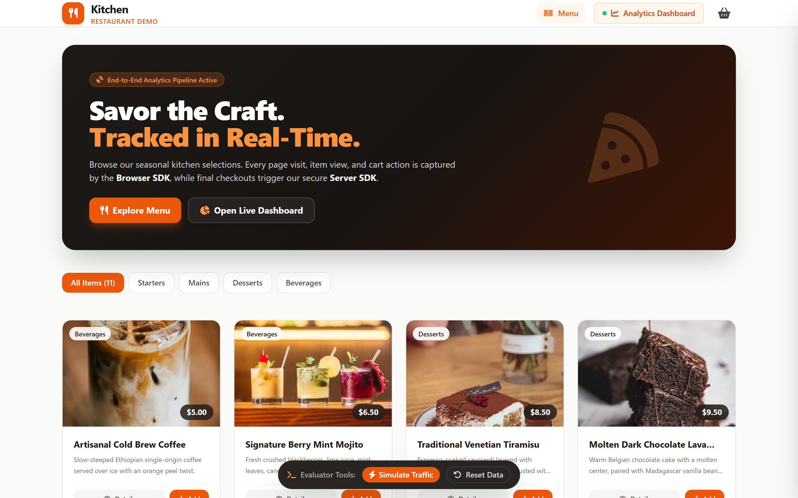
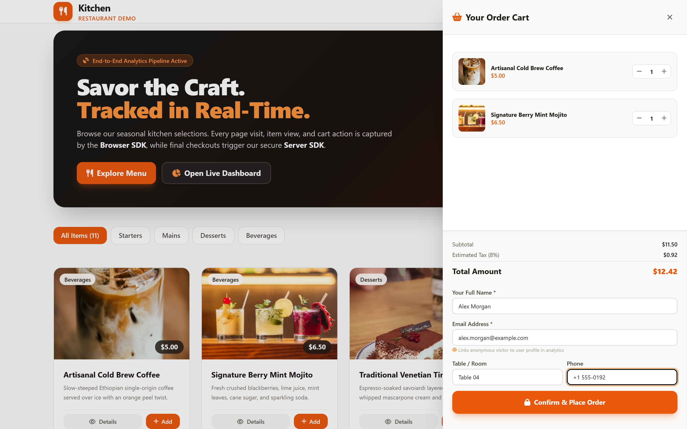
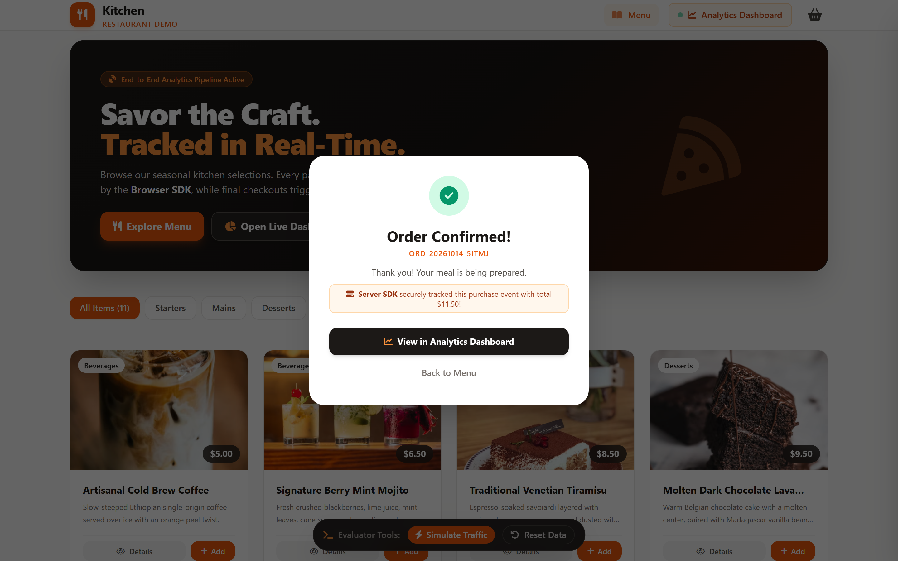
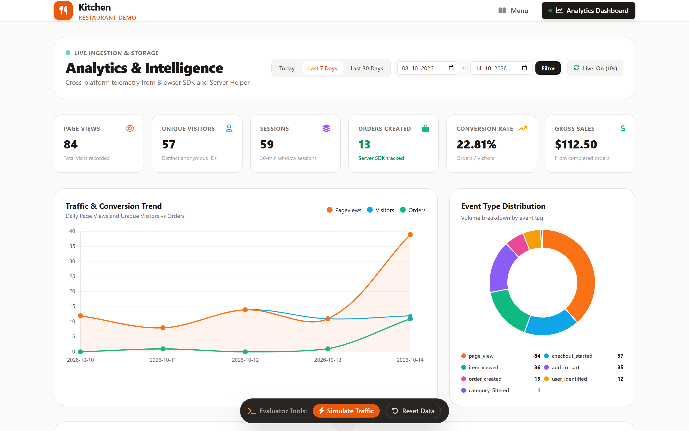
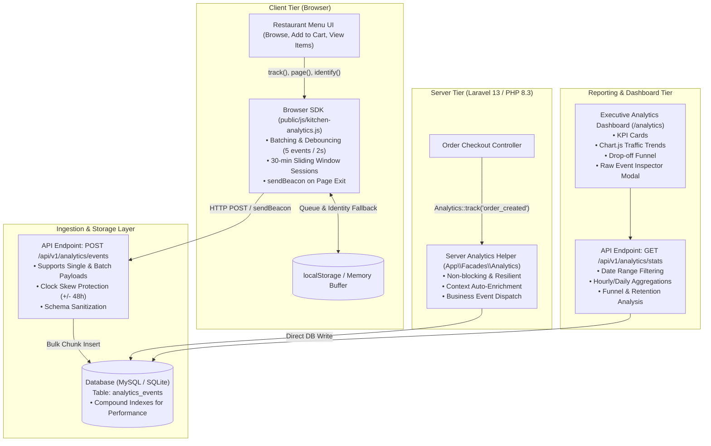

# 🍽️ Kitchen Spurs: Analytics SDK & Real-Time Intelligence Dashboard
> **Senior Software Engineer Assignment: Analytics SDK & Dashboard**  
> *A full-featured analytics pipeline capturing browser and server telemetry, high-throughput ingestion, indexed storage, conversion funnels, and real-time visualization inside an artisanal dining demo application.*

[](https://php.net)
[](https://laravel.com)
[-47A248?style=flat-square&logo=php&logoColor=white)](#-testing--quality-assurance)
[](#-testing--quality-assurance)
[](https://tailwindcss.com)
[](#-database-schema-design)

---

## 📸 System Showcase & Visual Walkthrough

Here is a live look at the application, customer ordering flow, and the real-time analytics intelligence dashboard:

### 1. Restaurant Demo Application & Artisanal Menu
> *Visitors browse seasonal menu items. Every page visit, category filter, and dish view triggers non-blocking telemetry via our lightweight Browser SDK.*



---

### 2. Interactive Cart Drawer & User Identification
> *Adding dishes increments cart telemetry (`add_to_cart`). When the user inputs their email, `KitchenAnalytics.identify()` seamlessly links their anonymous browsing profile to their customer account.*



---

### 3. Server-Side Tracking on Order Completion
> *Clicking "Confirm & Place Order" creates the order in MySQL. The backend controller dispatches an immutable `order_created` business event directly via our Server SDK.*



---

### 4. Executive Analytics Intelligence Dashboard
> *Real-time KPIs, conversion funnels, traffic trend graphs, popular page rankings, and live event telemetry with an interactive JSON payload inspector modal.*



---

## 📌 Executive Architecture & Data Flow



---

## 🚀 Key Deliverables Breakdown

### 1. Browser Analytics SDK (`public/js/kitchen-analytics.js`)
* **Zero Dependencies**: Pure vanilla JavaScript (< 4KB).
* **Identity Management**:
  * Persistent `anonymous_id` stored in `localStorage` with fallback to 1-year first-party cookie.
  * `session_id` sliding window refreshed after **30 minutes of user inactivity**.
  * `identify(userId, traits)` associates anonymous visitor history with authenticated users upon checkout.
* **Batching & Efficiency**: Buffers events in-memory and flushes in batches of 5 or every 2 seconds to minimize HTTP request overhead.
* **Unload Resilience**: Guarantees zero data loss when users close the tab or navigate away using `navigator.sendBeacon` and `fetch({ keepalive: true })`.
* **Offline Retry Buffer**: Buffers failed dispatches in `sessionStorage` and retries automatically when connection is restored.
* **Host Isolation**: Wrapped in fail-safe try-catch blocks so tracking anomalies **never disrupt the restaurant ordering flow**.

### 2. Server Tracking Helper (`App\Facades\Analytics` & `App\Services\Analytics\AnalyticsTracker`)
* **Strongly Typed Facade**:
  ```php
  use App\Facades\Analytics;

  Analytics::track(
      eventName: 'order_created',
      properties: [
          'order_id' => $order->id,
          'total_amount' => 38.50,
          'items_count' => 2,
          'currency' => 'USD',
      ],
      userId: $customerEmail,
      anonymousId: $anonymousId,
      sessionId: $sessionId,
      path: '/orders/checkout'
  );
  ```
* **Context Capture**: Auto-attaches client IP, User-Agent, server runtime environment, and authoritative server timestamps (`created_at` vs client `occurred_at`).
* **Fault Tolerant**: Catches database or network errors and logs them to Laravel channels without throwing exceptions into checkout transactions.

### 3. Ingestion & Storage API
* **Endpoint**: `POST /api/v1/analytics/events`
* **Batch & Single Payloads**: Transparently accepts both individual events and bulk batches `{ "batch": [...] }`.
* **Schema Validation & Sanitization**: Enforces required attributes, limits string lengths, and bounds client occurrence timestamps ($\pm 48\text{ hours}$) to mitigate device clock skew.
* **Optimized Database Schema**:
  ```sql
  CREATE TABLE analytics_events (
      id CHAR(36) PRIMARY KEY,
      event_name VARCHAR(64) NOT NULL,
      event_source VARCHAR(16) NOT NULL,  -- 'browser' | 'server'
      anonymous_id VARCHAR(64) NOT NULL,
      user_id VARCHAR(64) NULL,
      session_id VARCHAR(64) NOT NULL,
      url VARCHAR(2048) NULL,
      path VARCHAR(255) NULL,
      referrer VARCHAR(2048) NULL,
      properties JSON NULL,
      context JSON NULL,
      occurred_at TIMESTAMP NOT NULL,
      created_at TIMESTAMP NOT NULL,
      
      INDEX idx_event_occurred (event_name, occurred_at),
      INDEX idx_occurred_at (occurred_at),
      INDEX idx_anonymous_id (anonymous_id),
      INDEX idx_user_id (user_id),
      INDEX idx_session_id (session_id),
      INDEX idx_path (path)
  );
  ```

### 4. Interactive Analytics Dashboard (`/analytics`)
* **Live KPI Cards**: Total Page Views, Unique Visitors, Total Sessions, Server-tracked Orders, Conversion Rate, and Gross Sales.
* **Interactive Visualizations (Chart.js)**:
  * **Traffic Over Time**: Dual-axis line graph correlating Daily Page Views & Unique Visitors with Completed Orders.
  * **Popular Pages**: Ranked breakdown of the most-visited paths and their percentage share.
  * **Event Distribution**: Doughnut chart distinguishing browser actions from backend orders.
  * **Conversion Funnel**: Step-by-step visual pipeline (*Menu Visit $\rightarrow$ Item Viewed $\rightarrow$ Added to Cart $\rightarrow$ Checkout Started $\rightarrow$ Order Placed*) with percentage conversion.
* **Live Event Stream & Inspector**:
  * Real-time table of incoming telemetry tagged with `BROWSER` and `SERVER` badges.
  * Clickable **"Inspect"** button opening an interactive JSON modal displaying raw `properties` and `context`.
* **Date Range Filtering**: Presets for `Today`, `Last 7 Days`, `Last 30 Days`, and custom date selectors.
* **Live Polling**: Configurable 10-second automatic background refresh.

### 5. Restaurant Demo Application ("Kitchen" at `/`)
* **Menu Experience**: Browse artisanal dishes across *Starters, Mains, Desserts, and Beverages*.
* **Event Pipeline**:
  * Visiting the menu triggers `page_view`.
  * Filtering categories triggers `category_filtered`.
  * Viewing dish details triggers `item_viewed`.
  * Adding items to cart triggers `add_to_cart`.
  * Opening the checkout drawer triggers `checkout_started`.
  * Entering an email triggers `identify()`.
  * Completing the order triggers the **Server SDK** `order_created` event!
* **Evaluator Toolbar**: Floating bottom utility pill containing:
  * **"⚡ Simulate Traffic"**: Generates 25 realistic multi-day user sessions and orders with 1-click.
  * **"🧹 Reset Data"**: Clears telemetry tables for clean test passes.

---

## 🛠️ Step-by-Step Local Setup Guide

Follow these steps to run the project locally in under 2 minutes:

### 1. Clone the Repository
```bash
git clone https://github.com/vinayda786-glitch/kitchen_spurs.git
cd kitchen_spurs
```

### 2. Install Dependencies
```bash
# Install PHP dependencies
composer install

# Install Node dependencies
npm install
```

### 3. Environment Configuration
```bash
# Copy example environment file
cp .env.example .env

# Generate application key
php artisan key:generate
```

Configure your database in `.env` (MySQL or SQLite):
```env
# For MySQL:
DB_CONNECTION=mysql
DB_HOST=127.0.0.1
DB_PORT=3306
DB_DATABASE=kitchen_spurs
DB_USERNAME=root
DB_PASSWORD=

# Or for SQLite (zero-config):
# DB_CONNECTION=sqlite
```

### 4. Run Migrations & Seed Menu Items
```bash
# Run database migrations
php artisan migrate

# Seed sample restaurant dishes
php artisan db:seed
```

### 5. Start Development Server
```bash
php artisan serve
```

Visit the application in your browser:
* **Restaurant Demo**: [http://127.0.0.1:8000](http://127.0.0.1:8000)
* **Analytics Dashboard**: [http://127.0.0.1:8000/analytics](http://127.0.0.1:8000/analytics)

---

## 🧪 Testing & Quality Assurance

The codebase includes comprehensive **Unit Tests**, **Feature Tests**, and **Playwright End-to-End Tests**:

### 1. Run PHPUnit Test Suite
```bash
php artisan test
```

**Results: 17 Passed, 65 Assertions**
```text
   PASS  Tests\Unit\AnalyticsTrackerUnitTest
  ✓ tracker records event with properties
  ✓ tracker generates uuids when identifiers are null
  ✓ tracker identify creates user identified event
  ✓ analytics event scopes
  ✓ menu item model casting
  ✓ order relationship and calculations

   PASS  Tests\Unit\ExampleTest
  ✓ that true is true

   PASS  Tests\Feature\AnalyticsPipelineTest
  ✓ restaurant menu page renders successfully
  ✓ analytics dashboard page renders successfully
  ✓ ingestion api accepts valid single event
  ✓ ingestion api accepts batch events
  ✓ ingestion api rejects empty payload
  ✓ server tracker helper creates event safely
  ✓ order checkout flow creates order and triggers server analytics event
  ✓ dashboard stats api returns expected kpis and funnel
  ✓ simulate traffic generates events and orders

   PASS  Tests\Feature\ExampleTest
  ✓ the application returns a successful response

  Tests:    17 passed (65 assertions)
  Duration: 1.88s
```

### 2. Run Playwright Automated E2E Test
```bash
node tests/e2e/playwright-test.mjs
```

**Results: 100% Green E2E Flow**
```text
🚀 Starting Playwright E2E Test Suite for Kitchen Analytics...

1️⃣ Navigating to Home Menu (http://127.0.0.1:8000/)...
   Page Title: "Kitchen - Artisanal Dining & Online Ordering"
   Hero Banner Heading: "Savor the Craft. Tracked in Real-Time."

2️⃣ Testing Item Details Modal & Browser Telemetry...
   Opened Modal for: "Artisanal Cold Brew Coffee"

3️⃣ Adding Item to Cart...
   Cart Badge Count: 1
   Opening Cart Drawer...
   Cart Subtotal: $5.00

4️⃣ Testing Typing in Checkout Inputs (Verifying drawer does NOT close)...
   ✓ Typed name, drawer remained open.
   ✓ Typed email, drawer remained open.
   ✓ All inputs filled successfully without drawer closing.
   Clicking "Confirm & Place Order"...
   ✅ Order Created Successfully! Order Number: ORD-20261014-AQH6Z

5️⃣ Navigating to Analytics Dashboard (http://127.0.0.1:8000/analytics)...
   📊 Dashboard KPIs:
      - Total Page Views: 80
      - Unique Visitors: 56
      - Orders Created (Server SDK): 11
      - Live Event Feed Rows: 25

✅ Zero JavaScript runtime errors during entire flow!
🎉 ALL PLAYWRIGHT E2E TESTS PASSED 100% SUCCESSFULLY!
```

---

## 📡 API Reference

### 1. Ingestion API: `POST /api/v1/analytics/events`
Accepts single event or batch payload.

**Request Body:**
```json
{
  "batch": [
    {
      "event_name": "item_viewed",
      "event_source": "browser",
      "anonymous_id": "anon_92837194",
      "session_id": "sess_81726354",
      "user_id": null,
      "path": "/menu",
      "url": "http://localhost:8000/menu",
      "properties": {
        "item_id": 4,
        "item_name": "Margherita Pizza",
        "price": 14.50
      },
      "context": {
        "screen_width": 1920,
        "screen_height": 1080
      },
      "occurred_at": "2026-10-14T12:45:00Z"
    }
  ]
}
```

**Response (200 OK):**
```json
{
  "status": "success",
  "processed": 1,
  "failed": 0
}
```

### 2. Stats Reporting API: `GET /api/v1/analytics/stats`
**Query Parameters:**
* `from`: Start date `YYYY-MM-DD`
* `to`: End date `YYYY-MM-DD`

**Returns:**
Summary KPIs, time-series traffic, popular paths, event distribution, funnel progression, and the 25 most recent events.

### 3. Simulation Helper: `POST /api/v1/analytics/simulate`
Generates 25 synthetic realistic visitor sessions across 5 days with browses, cart adds, and completed orders for immediate visualization.

---

## ⚖️ Engineering Decisions & Trade-offs

| Engineering Choice | Chosen Implementation | Technical Rationale |
| :--- | :--- | :--- |
| **Delivery Strategy** | Dual: `sendBeacon` + `fetch(keepalive)` | Standard AJAX requests can be aborted if a visitor navigates away immediately after a click. `sendBeacon` guarantees browser delivery during tab close without UI lag. |
| **Clock Skew Mitigation** | Dual Timestamps: `occurred_at` & `created_at` | Client device clocks can be inaccurate or manipulated. Storing client `occurred_at` preserves user relative timing, while server `created_at` ensures absolute auditability. |
| **Event Schema Flexibility** | Structured Columns + JSON Payloads | Fixed typed columns for identity and timestamps enable index-backed fast queries, while `properties` JSON accommodates arbitrary application payload variations without schema migrations. |
| **Database Architecture** | Relational with Compound Indexes | Indexing `(event_name, occurred_at)` on MySQL provides sub-10ms aggregation without the operational overhead of maintaining a separate ClickHouse or Cassandra cluster. |
| **Graceful Degradation** | Silent Exception Handling | If the analytics endpoint experiences downstream outages, checkout and restaurant ordering operations continue unabated. Analytics should never take down revenue generation. |

---

## 👨‍💻 Author & Submission
* **Candidate**: Vinay Gupta
* **Assignment**: Senior Software Engineer - Analytics SDK & Dashboard
* **Repository**: [https://github.com/vinayda786-glitch/kitchen_spurs](https://github.com/vinayda786-glitch/kitchen_spurs)
